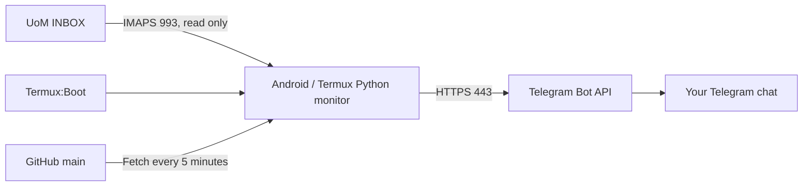

# UoM Email → Telegram on Android

**Created and maintained by [MN Rizni Mohamed](https://github.com/RizniMohamed).**

[](https://github.com/RizniMohamed/uom-email-telegram-monitor-template/actions/workflows/ci.yml)
[](LICENSE)
[](https://github.com/RizniMohamed/uom-email-telegram-monitor-template/stargazers)

An open-source template for forwarding your University of Moratuwa inbox to your own Telegram chat, using an Android phone as the server. Each student uses their own university account, bot, checkpoint, and phone. There is no central service collecting credentials or emails.

**If this project helps you, please star the repository and share it with your batchmates. Starring is optional; the code is freely available under the MIT license.**

## Start here

Read the **[complete setup guide](SETUP_GUIDE.md)**. It takes you from creating a Telegram bot to a running Termux monitor, boot startup, automatic updates, and recovery. It includes separate paths for a new installation and migration from an existing monitor.

To get the source on your phone:

```bash
git clone https://github.com/RizniMohamed/uom-email-telegram-monitor-template.git ~/uom-email-telegram-monitor
cd ~/uom-email-telegram-monitor
bash deployment/termux/uom.sh install "$PWD"
export PATH="$HOME/.local/bin:$PATH"
```

Install the prerequisites in the guide first. Installation does not start the real monitor. Configure your private environment file and initialize or migrate your checkpoint before `uom start`.

## How it works



The phone polls INBOX every 30 seconds, forwards new messages, and keeps university emails unread. Termux:Boot starts the manager after reboot when Android permits it. The manager restarts a crashed Python process and tests new GitHub commits before activation.

## Features

- Telegram HTML formatting, plain-text fallback, text previews, and safe links.
- Attachment forwarding, PDFs and Office files, photos, and referenced CID/inline images.
- Persistent UID/UIDVALIDITY and individual delivery acknowledgements.
- Pending-delivery recovery, attachment retries, skipped-file warnings, and Telegram rate-limit handling.
- Certificate-verified TLS, a credential-free TLS probe, and single-instance locks.
- Termux management commands, optional wake lock, and rotated private logs.
- Isolated release environments, offline tests before updates, and code rollback after failed health checks.

The application uses only `requests`, `beautifulsoup4`, and `python-dotenv`. Python 3.12+ is supported; CI targets Python 3.14. No root, webhook server, external database, or cloud deployment is required.

## Commands

| Command | Purpose |
| --- | --- |
| `uom start` | Start the manager and monitor; repeated calls keep one instance |
| `uom stop` | Stop both and pause Boot startup; retain the checkpoint |
| `uom restart` | Restart using the same checkpoint |
| `uom status` | Show process status, active commit, and latest update failure |
| `uom logs` | Show recent manager and monitor logs |
| `uom update` | Request an update check; when stopped, validate only |

## Private files

On the phone, these live outside the Git checkout and release folders:

```text
~/.local/share/uom-monitor/monitor.env
~/.local/share/uom-monitor/uom_monitor_state.json
```

The repository contains a blank [`.env.example`](.env.example), synthetic test emails, and source code. Never commit a filled environment file, bot token, university password, checkpoint, real email, or SSH private key.

## Source layout

```text
src/uom_email_monitor/     Python email, Telegram, configuration, TLS, and locking
tests/                    Offline tests using dummy credentials and synthetic emails
deployment/termux/         uom.sh manager and boot.sh launcher
.github/workflows/ci.yml   Python 3.14 tests, lint, package build, and shell checks
.env.example              Blank configuration template
pyproject.toml            Dependencies and package metadata
SETUP_GUIDE.md            Complete shareable setup instructions
LICENSE                   MIT license and author copyright notice
```

## Development and contributions

Use a development checkout with dummy configuration. Install `python -m pip install -e '.[dev]'` in a virtual environment, then run:

```bash
python -m unittest discover -s tests -t . -v
python -m ruff check src tests
bash -n deployment/termux/uom.sh
bash -n deployment/termux/boot.sh
```

Tests block external email/Telegram network access and use local Git fixtures. The real POSIX process/lock test runs on Linux/Termux and is skipped on Windows. CI does not use application secrets. Report bugs with synthetic messages and dummy values; never post actual mail or credentials.

Android may kill the entire Termux app despite battery settings; reopen it and use `uom start`. Phone reboot, screen-off behavior, and live delivery require verification on your device. The guide describes other limits, including the narrow crash window in which Telegram may receive an item twice.

## License and credit

Copyright © 2026 **MN Rizni Mohamed**. Released under the [MIT License](LICENSE). Keep the copyright and license notice in copies or substantial portions of the code. Forking, modifying, sharing, and commercial use are permitted by the license. Stars, README credit links, and sharing the original project are appreciated, not additional license conditions. Dependencies and external apps retain their own licenses.
